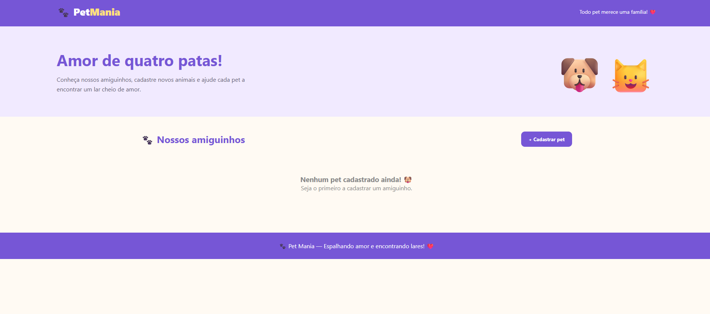
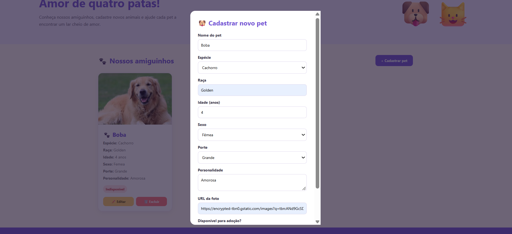
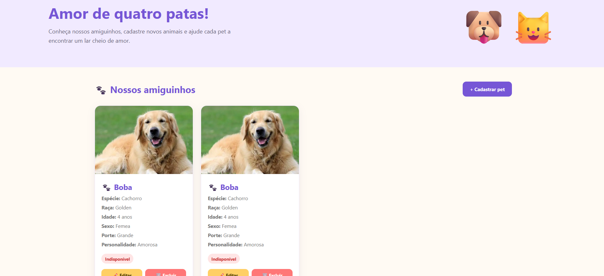
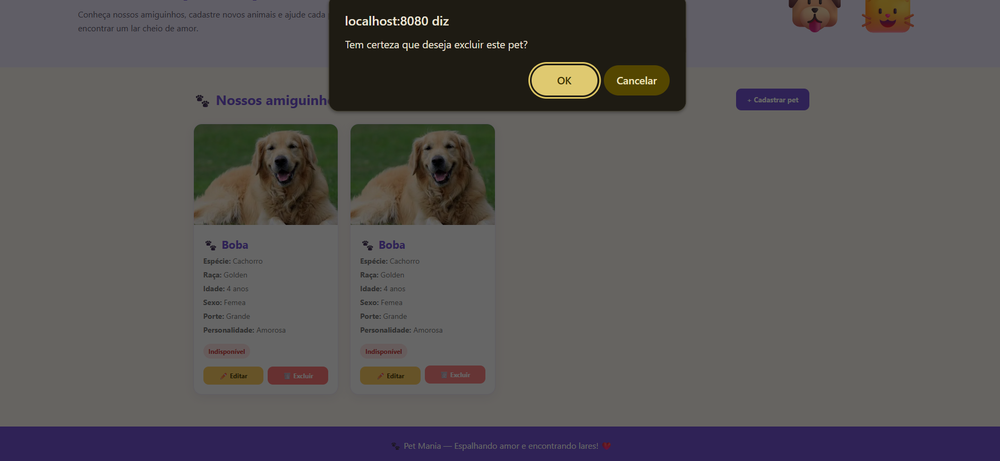
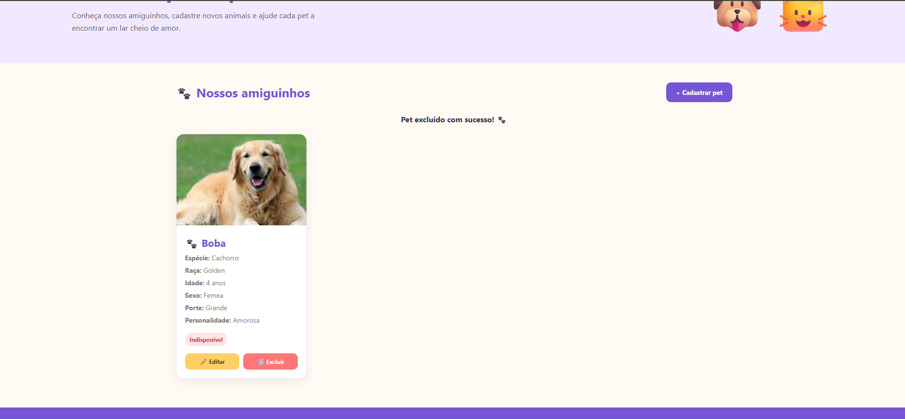
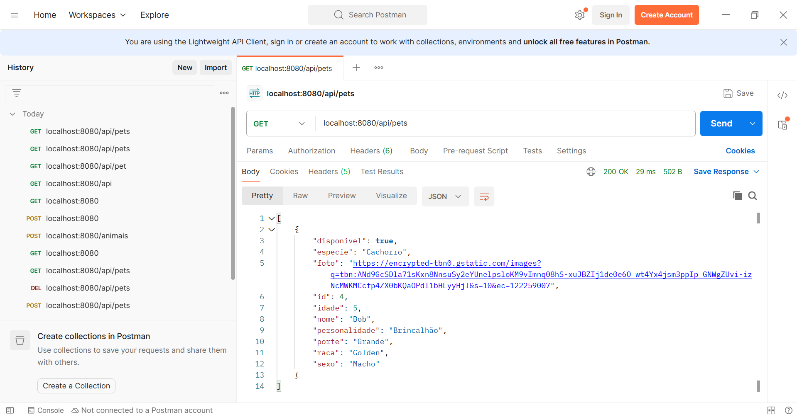
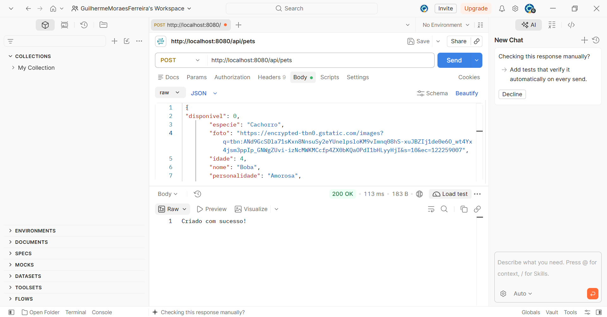
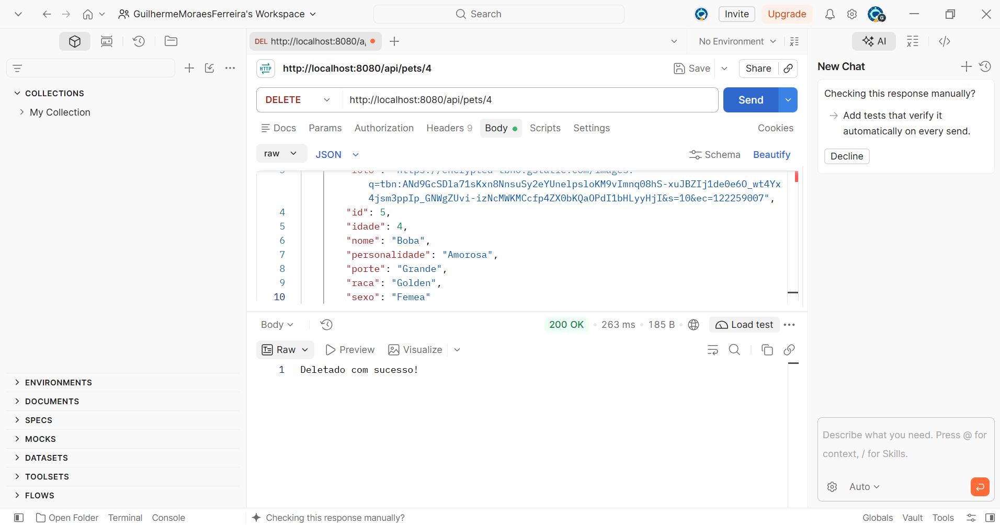

# Pet Mania — API Challenge

> Desafio prático de back-end focado na análise, correção de falhas, execução e validação de uma API RESTful para gerenciamento de animais (**Pet Mania**), integrada a uma interface front-end e testada via **Postman**.


##  Sobre o Desafio

O objetivo deste desafio foi diagnosticar e corrigir os problemas existentes no código da API **Pet Mania**, garantindo que todas as rotas funcionassem corretamente tanto na integração com o **front-end disponibilizado pela professora** quanto nos testes diretos de requisição HTTP utilizando o **Postman**.

---

##  Principais Correções Realizadas

*(Dica: edite ou marque abaixo os pontos que você ajustou no projeto)*

- [x] Correção nas rotas e métodos HTTP.
- [x] Ajuste nos códigos de status HTTP retornados pela API.
- [x] Validação do fluxo de leitura, cadastro e exclusão de registros.

---

##  Como Executar o Projeto

### Pré-requisitos

Antes de iniciar, certifique-se de ter instalado em sua máquina:
- [Git](https://git-scm.com/)
- Ambiente de execução do projeto *(ex.: Node.js / Java / Python)*
- [Postman](https://www.postman.com/) para testes das requisições

### Passo a Passo

1. **Clone o repositório:**
   ```bash
   git clone https://github.com/GuilhermeMFerreira/pet-mania-api-challenge.git
   ```

2. **Acesse a pasta do projeto:**
   ```bash
   cd pet-mania-api-challenge
   ```

3. **Instale as dependências e inicie a API:**
   *(Ajuste os comandos abaixo conforme a tecnologia utilizada no projeto)*
   ```bash
   # Exemplo para Node.js:
   npm install
   npm start
   ```

4. **Inicie o Front-end Pet Mania:**
   Abra a interface front-end disponibilizada para consumir a API localmente.

---

##  Endpoints da API

| Método | Rota           | Descrição | Status HTTP Esperado      |
| :--- |:---------------| :--- |:--------------------------|
| `GET` | `/api/pets`    | Lista todos os animais cadastrados | `Nenhum HTTP observado.`  |
| `POST` | `/api/pets`    | Cadastra um novo animal | `Criado com sucesso.`     |
| `DELETE` | `/api/pets/id` | Remove um animal pelo seu `ID` | `Deteletado com sucesso.` |

### Exemplo de Corpo da Requisição (`POST`)

```json
{
  "disponivel": 1,
  "especie": "Cachorro",
  "foto": "https://encrypted-tbn0.gstatic.com/images?q=tbn:ANd9GcSDla71sKxn8NnsuSy2eYUnelpsloKM9vImnq08hS-xuJBZIj1de0e6O_wt4Yx4jsm3ppIp_GNWgZUvi-izNcMWKMCcfp4ZX0bKQaOPdI1bHLyyHjI&s=10&ec=122259007",
  "idade": 5,
  "nome": "Bob",
  "personalidade": "Brincalhão",
  "porte": "Grande",
  "raca": "Golden",
  "sexo": "Macho"
}
```

---

## Modo de Entrega e Evidências

Abaixo estão registradas as evidências de funcionamento da aplicação integrada ao front-end e a validação completa dos endpoints via Postman.

---

### 3. Aplicação em Funcionamento (Front-end Pet Mania)

Após a correção dos problemas e inicialização do servidor, a aplicação foi testada diretamente pela interface **Pet Mania**, validando o fluxo completo de interação com o usuário:



#### 3.1. Cadastrar um novo animal
Validação do formulário de cadastro e envio dos dados para a API:



#### 3.2. Visualizar os animais cadastrados
Listagem em tela dos registros retornados pela API:



#### 3.3. Excluir um animal
Remoção de um registro através da interface e atualização da lista:




---

### 4. Testes da API com Postman

Além do front-end, todos os endpoints foram testados diretamente no **Postman**, observando os **códigos de status HTTP**, o **corpo das respostas** e a **integridade dos dados**.

#### 4.1. `GET` — Consultar todos os animais
- **Status HTTP observado:** `Nenhum HTTP observado.`
- **Observação:** Retorno da lista completa de animais cadastrados em formato JSON.



---

#### 4.2. `POST` — Cadastrar um novo animal
- **Status HTTP observado:** `criado com sucesso`
- **Observação:** Envio do payload JSON e confirmação do novo registro criado com seu respectivo ID.



---

#### 4.3. `DELETE` — Excluir um animal
- **Status HTTP observado:** `Deletado com sucesso.`
- **Observação:** Exclusão confirmada do registro pelo ID e validação de que o item não consta mais na listagem.



---

## Autor

Desenvolvido por **Guilherme M. Ferreira**  
GitHub: [@GuilhermeMFerreira](https://github.com/GuilhermeMFerreira)